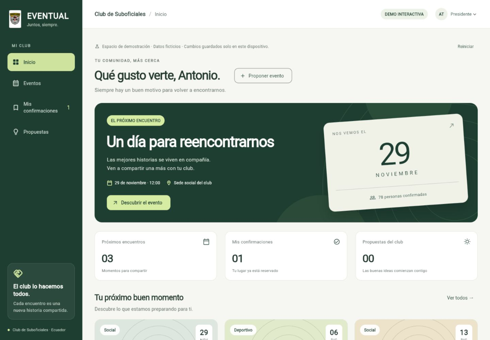

# EVENTUAL

Planificación de eventos y gestión económica para clubes, con una experiencia accesible para socios y directiva.

**Estado: primera demo interactiva en Flutter.** Incluye inicio, eventos, búsqueda, calendario, confirmaciones con acompañantes y propuestas con aprobación simulada. Usa datos ficticios y almacenamiento local; API, autenticación y finanzas todavía están pendientes.

## Ejecutar la demo

El mismo cliente Flutter se compila para navegador, Android y Windows. La publicación web y las descargas de prueba se generan desde [GitHub Actions](https://github.com/Vonchox/Eventual/actions).

- **Web:** habilita **GitHub Actions** como origen en [Settings → Pages](https://github.com/Vonchox/Eventual/settings/pages). El flujo **Publicar EVENTUAL web** publica el cliente al ejecutar el flujo manualmente o al subir cambios del cliente a `main`.
- **Android:** descarga **Eventual-Android-APK** del flujo **Compilar EVENTUAL para Android y Windows**, extrae el archivo e instala `app-debug.apk` en el dispositivo. Es una compilación de prueba.
- **Windows:** descarga **Eventual-Windows-x64** del mismo flujo. Extrae todo el ZIP y abre `eventual_client.exe` dentro de la carpeta extraída.

[Abrir la demo privada en Sites](https://eventual-club-demo-vonchox.airycornbread.chatgpt.site). Requiere iniciar sesión con la cuenta de ChatGPT propietaria del sitio. La publicación de Sites fue confirmada; la revisión interactiva se realizó sobre la misma compilación servida localmente.

Con Flutter 3.47.6 / Dart 3.13.5 y sus herramientas de plataforma:

```powershell
cd apps/client
flutter pub get
flutter run -d chrome
```

Para Windows: `flutter run -d windows`. Para Android: conectar un dispositivo/emulador y ejecutar `flutter run`. Los directorios de los tres destinos están preparados; consultar la [guía de la demo](apps/client/README.md) para el estado de validación y los requisitos del entorno.

Elegir un evento, confirmar con acompañantes y consultar **Mis confirmaciones**. En **Propuestas**, enviar una idea y cambiar el selector superior de **Socio** a **Presidente** para aprobarla. El selector simula perfiles y no representa autenticación. **Reiniciar** restaura los ejemplos.



EVENTUAL nace de un proyecto académico para un Club de Suboficiales retirados. Su objetivo es acompañar el ciclo de un evento: propuesta, aprobación, planificación, difusión, confirmación, asistencia, cierre y consulta de resultados económicos.

## Experiencia prevista

| Perfil | Tareas principales |
| --- | --- |
| Socio | Consultar eventos, proponer actividades, confirmar asistencia y acompañantes, consultar su información. |
| Presidente | Administrar miembros, aprobar y registrar eventos, controlar asistencia y cerrar eventos. |
| Tesorero | Registrar aportes y gastos, evaluar cotizaciones y consultar balances. |
| Secretario | Mantener proveedores y difundir eventos. |

Los permisos detallados están pendientes de consolidación; algunas descripciones originales difieren entre sí.

## Objetivo multiplataforma

La propuesta técnica conserva Flutter/Dart para el cliente, Node.js/Express para la API y MySQL para los datos. Se propone añadir TypeScript en el servidor. La lógica de permisos, cupos, estados y movimientos económicos residirá en el servidor.

| Plataforma | Uso previsto | Orden propuesto |
| --- | --- | --- |
| Web | Demo accesible por enlace y gestión desde navegador. | Primera entrega funcional. |
| Android | Consulta, confirmación y asistencia durante eventos. | Validación temprana junto con web. |
| Windows | Trabajo administrativo con teclado, tablas y archivos. | Después de estabilizar el flujo principal. |
| iOS, macOS y Linux | Ampliación según herramientas y pruebas disponibles. | Evolución posterior. |

Compartir código no elimina las adaptaciones de interfaz ni las pruebas por plataforma. El alcance y los riesgos se detallan en el [análisis de viabilidad](docs/viabilidad.md).

## Documentación

- [Fuentes y procedencia](docs/fuentes.md).
- [Viabilidad, hallazgos y revisión de costos](docs/viabilidad.md).
- [Arquitectura propuesta](docs/arquitectura.md).
- [Requisitos y decisiones pendientes](docs/requisitos.md).
- [Plan de entregas y presentación de portafolio](docs/roadmap.md).
- [Alcance y validación de la primera demo](docs/demo-etapa-1.md).
- [Documentos originales](docs/referencias/).

## Qué debe demostrar la primera versión

Un socio propone una actividad. La directiva la aprueba y publica. Los socios confirman su asistencia sin exceder el aforo. El tesorero registra movimientos y consulta el saldo. El presidente registra asistencia y cierra el evento. El sistema produce un resumen verificable.

La accesibilidad para adultos mayores, la consulta de eventos previamente descargados sin conexión y la trazabilidad económica son objetivos centrales del producto.

## Origen y contribuciones

La documentación académica identifica a Dylan Alexander Alvarado Palacios, Pablo Antonio Campoverde Jimenez y Stiven Hernán Díaz Fonseca. Las contribuciones de implementación deberán documentarse conforme se realicen. Este repositorio no atribuye el trabajo académico colectivo a una sola persona.

Los originales se conservan como evidencia de origen. Incluyen datos de contacto y enlaces externos; preparar una copia pública revisada antes de publicar esos archivos. No se ha seleccionado una licencia de redistribución para el material académico.
