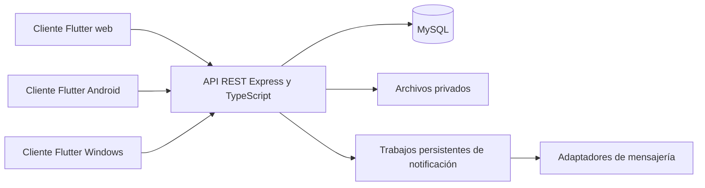

# Arquitectura propuesta

Estado: cliente Flutter de demostración implementado; API y base de datos pendientes. La ERS original ya plantea Flutter/Dart, Node.js/Express, REST/JSON y MySQL. Se conserva esa base y se propone TypeScript para el backend. El diagrama representa el objetivo final, no los servicios actualmente desplegados.



## Organización prevista

```text
apps/
  client/               # Un proyecto Flutter con destinos web, Android y Windows
  api/                  # API Express y TypeScript
docs/                   # Documentación y decisiones
infra/                  # Entorno local y despliegue
```

`apps/client/` ya contiene la demo Flutter con persistencia local. Las carpetas de API e infraestructura siguen siendo un objetivo. Preferir un monolito modular con una base de datos. La escala conocida no justifica microservicios.

## Módulos y datos

| Módulo | Entidades previstas |
| --- | --- |
| Identidad y miembros | Usuario, socio, rol, sesión, invitación. |
| Eventos | Propuesta, evento, transición de estado, actividad. |
| Participación | Confirmación, acompañante, asistencia. |
| Finanzas | Aporte, gasto, presupuesto, categoría, movimiento, liquidación. |
| Proveedores | Proveedor, servicio, cotización. |
| Comunicación | Notificación, programación, intento de entrega. |
| Evidencias | Archivo y registro de auditoría. |

Un solo club en el MVP. Una futura plataforma para varios clubes requerirá aislamiento de organizaciones y autorización por organización; no está incluido en la estimación base.

## Reglas técnicas de diseño

- Validar permisos y estados en el servidor en cada operación. Ocultar un botón no constituye autorización.
- Guardar dinero con precisión decimal o unidades mínimas enteras, con moneda explícita; evitar operaciones contables con coma flotante.
- Registrar movimiento y actualización económica en una transacción. Los reintentos no deben crear dos pagos o dos gastos.
- Reservar cupos de socio y acompañantes en una operación atómica. Dos solicitudes simultáneas no pueden exceder el aforo.
- Clave única de confirmación por socio/evento y asistencia por participante/evento. Identificador idempotente para operaciones reintentables.
- Corregir movimientos económicos con operaciones trazables; definir anulaciones y reversos antes de permitir borrar registros.
- Emitir identificadores de evento únicos en el servidor. El formato EVT-YYYY-NNN debe aclarar qué sucede si se superan 999 eventos anuales.
- Contraseñas con hash adaptativo y sal; invitaciones aleatorias con vencimiento. Sesiones revocables al desactivar un usuario o cambiar permisos.
- Definir almacenamiento de sesión por destino: cookies seguras en web si se adopta ese modelo y almacén protegido del sistema en nativo. Resolver CORS/CSRF según el contrato elegido.
- Comprobantes y contratos en almacenamiento privado; controlar tipo, tamaño y autorización para descarga. No exponer archivos mediante rutas públicas predecibles.
- Programaciones persistentes para notificaciones, reintentos limitados y registro de resultados. Un fallo de WhatsApp no revierte una propuesta guardada.

Estas reglas son propuestas de implementación, no evidencia de controles existentes. La recomendación de hashing se apoya en [OWASP](https://cheatsheetseries.owasp.org/cheatsheets/Password_Storage_Cheat_Sheet.html).

## Interfaz y adaptadores

Compartir modelos y lógica de presentación; adaptar navegación y disposición al espacio disponible. Móvil prioriza tareas breves y controles grandes. Escritorio prioriza tablas legibles, filtros y teclado. Web necesita URLs, historial y estados recuperables al recargar.

Encapsular cámara, QR, archivos, exportaciones, notificaciones y caché tras interfaces. Verificar la compatibilidad de cada complemento en los tres destinos antes de incorporarlo. Empezar con asistencia manual y QR como mejora posterior.

La caché inicial solo cubre eventos consultados. Debe mostrar antigüedad y limpiarse al cerrar sesión cuando corresponda. El servidor es la autoridad para cupos, permisos y finanzas.

## Operación y distribución

Proponer un entorno local reproducible para API/MySQL, migraciones versionadas, configuración de ejemplo sin secretos y datos ficticios. Añadir integración continua cuando exista código: análisis estático, pruebas de reglas y compilación de destinos.

GitHub aloja código y documentación. El cliente web estático necesita hosting; la API, MySQL y los archivos necesitan servicios de ejecución y persistencia. Un hosting estático por sí solo no ejecuta toda la aplicación. Publicar instaladores y APK mediante versiones cuando estén probados. Medir costos de infraestructura después de elegir proveedores y volumen.
